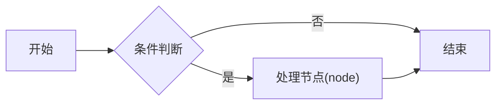

## 概览

- 参考文档：[CommonMark Spec](https://commonmark.org/)
- 本文不讲解任何知识，只展示本站文章的书写风格：标题命名、章节命名、列表嵌套、代码块、数学公式、流程图与标点
- 正文是嵌套无序列表形式的精简中文笔记，一条只讲一件事，条目之间直接相连，**不插空行**(唯一例外是条目内的代码块)
- **不设`总结`、`要点`、`最佳实践`这类收尾章节**：需要强调的注意事项与最佳实践写进正文相应位置的条目里，用加粗就地强调

## 标题与列表

### 层级与缩进

- 一级条目只讲一件事，句子不以`。`结尾
  - 二级嵌套用`2`个空格缩进
    - 三级细节用`4`个空格缩进
- 优先用嵌套条目展开子话题，只有子话题大到条目装不下时，才给它单独的章节
- 加粗用于强调**关键结论**，行内代码用于`API`、命令、字段、类型与文件名
- 链接形如[示例](https://example.com)，链接与代码内的冒号用半角`:`

### 标点

- 分隔符用`:`，不用`—`
- 中文正文的逗号与冒号用全角`，`与`：`，句尾不加`。`
- 引号与括号一律用半角`"..."`与`(...)`

## 代码块

- 代码块挂在条目下，保持条目的缩进，**始终带语言标签**：

  ```go
  func example() error {
      return nil
  }
  ```

- 配置内容同样缩进到条目层级：

  ```yaml
  server:
    host: "0.0.0.0"
    port: 8080
  ```

## 数学公式

- 行内公式写作`$...$`，例如$a_{i} + b_{i} = c_{i}$
- 块级公式独占一段：

$$
\sum_{i=1}^{n} x_{i} = x_{1} + x_{2} + \cdots + x_{n}
$$

## 流程图

- **禁止用纯文本代码块画图**，任何流程图、状态机、拓扑都是`mermaid`代码块
- 节点标签含括号时要加引号，边标签放在竖线里：



## 引用

> 引用块单独成段，承载一条定义或一条结论，内部同样遵守标点规则

## 命名风格

- 标题直接用主题名，讲操作与流程的标题用动词短语，宾语落在具体对象上，编号信息由日期与链接承担
- 缩写、别名与补充说明用半角括号跟在名称后，`入门`、`基础`这类定位词缀在标题末尾
- 所有章节名(`##`与`###`)统一用短名词短语：概念与对象直接用名称，方法与算法用专有名，操作与过程用动宾短语
- 并列对象用`与`、`和`连接，英文技术名写成行内代码
- 章节需要限定范围或列举所涉命令时，用半角括号跟在名词短语后
- 全篇总览的章节用`概述`，补充内容用`附`或`附录`
- 正文适当用链接引用相关文档与本站其他文章，把主题串起来
- 条目先给术语或结论，再用`：`引出嵌套细节，关键词用行内代码或英文原词
- 无序列表优先，仅当顺序本身承载编号语义时才用有序列表
- 正文第一个条目是`参考文档：[名称](URL)`，来源按优先级选择：
  - 算法类：OI Wiki(`https://oi-wiki.org/`)与英文 Wikipedia 并列
  - 其他：软件官方 wiki 或文档站
  - 兜底：英文 Wikipedia
- `summary`是一行中文概述
- 分类用英文、从宽到窄排列，复用相似文章的分类，没有合适的再新建
- 标签用小写英文，复用相似文章的标签，没有合适的再新建
- 操作类文章的章节依次为`概述`、`快速开始`与若干专题章节
- `概述`先给一句定义，再用清单列职责或组成，操作类文章配一张`mermaid`拓扑图
- `summary`概括全篇内容，操作类文章用`、`列举所覆盖的专题
- 代码示例的注释用中文，写在行尾并按列对齐
- 同一概念全篇只用一个名称，选行业通称
